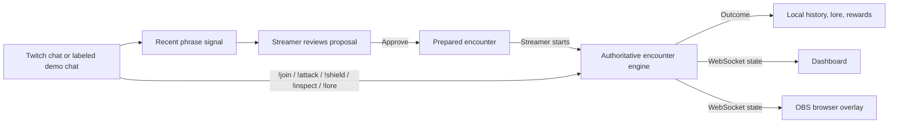

# OFFSCRIPT

**Your chat. Your chaos. Your legend.**

OFFSCRIPT turns a stream community's recurring jokes into cooperative boss encounters. A streamer reviews the encounter idea, starts the fight, and viewers work together through chat commands. The result can become a saved community memory and, for a first victory on that encounter theme, a reward.

Unlike a generic chat-controlled game, OFFSCRIPT starts with the community's own repeated phrase: the evidence is shown to the streamer, the streamer decides whether it becomes a prepared encounter, and the fight writes that phrase into persistent community lore. Chat commands power the battle, but the community's running joke gives the battle its identity.

## The problem and who it is for

Streamers have running jokes and active chat, but those moments often disappear as soon as the stream ends. OFFSCRIPT gives Twitch streamers and their communities a shared, streamer-controlled activity that turns chat culture into a short game and a growing history.

The product combines repeated-phrase encounter proposals, cooperative live play, an OBS browser overlay, and persistent outcomes. This local build supports both simulated chat and an optional, read-only Twitch chat connection.

## Product loop

Chat messages → repeated community phrase → encounter proposal → streamer approval → cooperative boss fight → outcome, reward, and lore.

The local sample conversation repeats “one more run” and produces a deterministic proposal. The proposal labels its source and generation method. The streamer reviews and approves it before starting an encounter.

## Technology and architecture

- React 18 and TypeScript for the dashboard and overlay.
- During local development, Vite serves the frontend on port 5173 and proxies API, OAuth, and WebSocket traffic to Express on port 3001.
- Express owns the game API and authoritative in-memory encounter state. In production, it also serves the built frontend from the same HTTPS origin.
- A single WebSocket endpoint (`/socket`) broadcasts state to the dashboard and OBS overlay; the browser selects `ws:` or `wss:` from the page's current origin.
- Node's file system stores completed encounter history, memories, and reward eligibility in `data/offscript.json` by default. Production must point this file at durable storage.
- The encounter studio uses a deterministic repeated-phrase fallback. It does not call an AI service.



Twitch messages arrive through EventSub, are deduplicated, and then enter the same encounter engine used by demo controls. Terminal Twitch outcomes are saved before the dashboard and OBS overlay receive the update. Demo events remain labeled as simulated.

The game engine validates phase transitions, participant membership, cooldowns, damage limits, shield capacity, and reward eligibility. A team shield stores up to three charges. Every 20 seconds, a charge blocks a pressure wave; without one, the wave removes five seconds from the timer. `!inspect` provides a phase-aware hint with its own cooldown.

## Requirements

- Node.js 20 or newer
- npm

## Run locally

From the repository folder:

```sh
npm install
npm run dev
```

Open <http://localhost:5173> for the dashboard. The Express API is at `http://localhost:3001`. Open <http://localhost:5173/?overlay> as an OBS Browser Source (for example, 1280 × 720).

Without Twitch credentials, the application stays in demo mode; all demo actors and messages are explicitly labelled simulated. A paid AI key is not required.

## Repeatable demo

1. Open the dashboard and click **Load sample conversation**. Four labelled simulated messages repeat “one more run.”
2. Review the encounter proposal, including its source and deterministic fallback label. Click **Approve proposal**.
3. Click **Start event** and open the overlay preview in another tab or OBS.
4. Disconnect Twitch, then click **Run phased demo replay**. Four simulated viewers join, the same encounter engine broadcasts the Awakening, Fracture, and Final stand phases, a team ward blocks a pressure wave, and the group wins.
5. Keep the OBS preview open. Show the boss phases, health, score, participants, clearly labeled `DEMO` activity, reward, and saved lore/history arriving over the shared WebSocket.
6. Restart the local app and reload the dashboard to confirm that the result was saved to disk. **Reset scenario** clears the current battle state; it does not erase history or grant rewards.

### Official video plan (2:45 target)

The hackathon video must show the real project working on Twitch and how it was built with Codex. Use a real Twitch encounter for the main story; keep the simulated replay as a labeled backup shot. See the [final hackathon rules](https://twitchcon-codex.devpost.com/rules) before recording and publishing.

- **0:00–0:12** — Hook: “Your chat's running joke becomes tonight's boss and tomorrow's community lore.” Show the dashboard's live subscription status.
- **0:12–0:32** — Capture real channel chat repeating the same joke and the Twitch-sourced proposal with its evidence count and time window.
- **0:32–0:48** — Approve the proposal; show that it becomes prepared and still requires the streamer to start it.
- **0:48–1:00** — Start the encounter and bring the OBS overlay beside the dashboard.
- **1:00–1:43** — Show real `!join` and `!attack` messages change participants, HP, activity, and boss phases in both views. Use several viewers to reach the phase thresholds; preserve the `TWITCH` activity labels.
- **1:43–2:00** — Show victory, the unique reward, and the lore/history entry. If you claim restart persistence, show the backend restart before the entry reappears.
- **2:00–2:28** — Show the actual Codex thread/code/test workflow that built and checked the integration. Do not stage fake terminal output or expose credentials.
- **2:28–2:45** — Close with the difference from a generic chat game: the running joke shapes the encounter and is kept as community history.

Record only your own channel and project. Avoid third-party creator footage, unrelated logos/art, and copyrighted music. Keep chat messages legible and crop unnecessary platform chrome; use original narration or no music.

Use an actual screen recording of the running app. Do not describe simulated messages as real Twitch chat.

## Viewer commands

- `!join` — join the current live encounter.
- `!attack` — deal up to 300 damage; each participant has a three-second action cooldown.
- `!shield` — add one of at most three team ward charges. A ward blocks one 20-second pressure wave.
- `!inspect` — get an encounter hint; each participant has a 15-second inspect cooldown.
- `!lore` — recall the latest saved community memory.

Participants must join before using attack, shield, or inspect. The dashboard's simulated controls call the same server engine. Resetting an encounter does not award a victory, and the same boss/theme combination cannot award its badge repeatedly.

## Commands

```sh
npm run dev       # Vite dashboard and Express/WebSocket server
npm test          # engine, Twitch/EventSub, community, gameplay, persistence, and demo lifecycle tests
npm run build     # server TypeScript compile and Vite production build
npm start         # start compiled production app (set NODE_ENV=production to serve the frontend)
```

Development uses the Vite proxy for `/api`, `/auth`, and `/socket`. Production builds the frontend into `dist/`; Express serves those assets and the SPA routes alongside the API and WebSocket.

## Screenshots to capture

The repository does not include product screenshots yet. Before submitting, capture real screenshots from the running app and add them under `docs/screenshots/`:

- `dashboard-proposal.png` — repeated phrase, evidence window, and streamer approval controls.
- `live-encounter.png` — boss phase, health, chat activity, and participant stats.
- `obs-overlay.png` — the compact overlay at a typical 1280 × 720 browser-source size.
- `community-memory.png` — a completed encounter with its reward and saved history entry.

## Configuration

Copy `.env.example` to `.env` to configure local credentials. OFFSCRIPT loads this file in the server process; `.env` is ignored by Git. Keep the client secret in this file on your own machine and never paste it into chat, frontend code, or a commit.

- `PORT` — Express/WebSocket port (default `3001`).
- `HOST` — bind interface (default `0.0.0.0`; use the platform's assigned interface if it specifies one).
- `OFFSCRIPT_DATA_FILE` — local JSON history path (default `data/offscript.json`).
- `TWITCH_CLIENT_ID` — client ID from your Twitch developer application.
- `TWITCH_CLIENT_SECRET` — confidential application secret; keep it server-side.
- `TWITCH_REDIRECT_URI` — the exact HTTPS Quick Tunnel URL ending in `/auth/twitch/callback`; keep it current because a Quick Tunnel hostname changes when restarted.
- `DASHBOARD_URL` — where OAuth returns after connection (default `http://localhost:5173/`).

### Single-origin production deployment

The simplest deployment is one Node service behind a hosting platform's HTTPS reverse proxy. The proxy sends the dashboard, `/api`, `/auth`, and `/socket` to the same Node process and supports WebSocket upgrades. Express serves the Vite build, so there is no production Vite proxy or separate frontend origin. The current client already uses relative API URLs and a same-origin WebSocket URL.

Use a host that provides a durable mounted volume and run exactly one application instance. The in-memory encounter engine and EventSub connection are single-process state; horizontal replicas would have different game state and could create competing Twitch connections. Point `OFFSCRIPT_DATA_FILE` at a file on the mounted volume. The application writes a temporary file beside it and atomically renames it into place, so the volume must support normal same-filesystem rename behavior. Do not put this file on an ephemeral filesystem and assume it will survive a restart. If the host has no persistent volume, the saved history and reward eligibility can be lost; this code does not provide a remote database.

Configure these environment variable names in the host's secret/configuration settings (do not use `VITE_*` for Twitch credentials):

- `NODE_ENV` — set to `production` so Express serves the built frontend.
- `PORT` — the port assigned by the host.
- `HOST` — bind interface; defaults to `0.0.0.0` for container hosts.
- `OFFSCRIPT_DATA_FILE` — absolute path to the JSON file on the durable volume.
- `TWITCH_CLIENT_ID` and `TWITCH_CLIENT_SECRET` — server-side Twitch application credentials. Keep the secret in the host's secret manager.
- `TWITCH_REDIRECT_URI` — the permanent HTTPS deployment origin plus `/auth/twitch/callback`, with no query or fragment. Register this exact URI in the Twitch application.
- `DASHBOARD_URL` — the permanent HTTPS deployment origin with a trailing `/`; OAuth returns here after authorization. Production Twitch authorization stays disabled unless this is set to the same HTTPS origin as `TWITCH_REDIRECT_URI`.

The service binds to `HOST` and `PORT`. It checks `/api` and `/auth` routes before serving static files, serves Vite assets from `dist/`, and sends browser HTML-navigation routes to the SPA entry point. `/api/health` is the existing liveness endpoint. The WebSocket remains at `/socket` on the same origin; the HTTPS proxy must forward WebSocket upgrade requests. Configure the reverse proxy to preserve the public `Host` header and terminate HTTPS. OAuth uses a host-only, `Secure`, `HttpOnly`, `SameSite=Lax` state cookie scoped to `/auth/twitch/callback`; the app checks the incoming `Host` against the configured callback host and does not trust arbitrary forwarded-host headers. TLS termination does not require Express to infer HTTPS for this cookie because `Secure` is set explicitly.

Build and run commands for the host:

```sh
npm ci && npm run build
npm start
```

Deployment steps:

1. Choose a Node hosting service that supports HTTPS ingress, WebSocket upgrades, and a durable mounted volume. Create one service instance and attach the volume.
2. Set the build command to `npm ci && npm run build` and the start command to `npm start`. Configure `NODE_ENV`, `PORT`, `HOST`, and `OFFSCRIPT_DATA_FILE` as described above. Use the absolute path of the mounted volume for the data file.
3. Once the host assigns the permanent public HTTPS origin, set `DASHBOARD_URL` to that origin and `TWITCH_REDIRECT_URI` to that same origin followed by `/auth/twitch/callback`. Store the Twitch client ID and secret in the host's protected environment settings.
4. In the Twitch Developer Console, register that exact `TWITCH_REDIRECT_URI`. This manual console change is required before real OAuth can work. The callback, dashboard, API, and WebSocket must all use the same public origin.
5. Deploy the built service. Confirm the host routes ordinary HTTPS requests and WebSocket upgrades to the same process, preserves the external `Host` header, and mounts the durable volume at the configured path.
6. Open the permanent HTTPS dashboard, connect Twitch, approve the requested read-only chat permission, and confirm the return to `DASHBOARD_URL`. Open the overlay at the same origin with `/?overlay` in OBS.

Restart behavior: a normal EventSub socket loss is retried with increasing delays up to 30 seconds; Twitch's migration messages are followed using the supplied reconnect URL, and the app reports connected again after the migrated session is accepted. A process/host restart is different: the Twitch access and refresh tokens and active encounter state are memory-only, so Twitch must be authorized again and any in-progress encounter starts over. Completed history, memories, and rewarded encounter keys return from the mounted JSON file. If persistent history cannot be read or valid JSON is not present, the server now fails at startup rather than silently creating an empty history.

The dashboard has no account/authentication layer. Anyone who can reach a public deployment can call the game controls, including simulated/demo controls. Restrict access at the hosting layer or deploy only where that behavior is acceptable; this deployment preparation does not add streamer login or authorization.

### Production smoke test

- Open the HTTPS root and a nested client route; both should render the dashboard. Confirm `/api/health` returns a successful response.
- Open `/?overlay` in a browser and OBS. Confirm both update from the same state.
- Start a simulated demo. Confirm its activity is labeled simulated; end/reset it before connecting Twitch.
- Start OAuth from the dashboard. Confirm Twitch returns to the exact HTTPS callback and the dashboard comes back without a state-cookie error.
- Confirm the status changes to connected only after the EventSub chat subscription is confirmed. Send `!join` and `!attack` from the authorized Twitch channel and verify the dashboard and overlay update with Twitch-labeled activity.
- Complete a victory, verify the reward/history entry, restart the service, and verify the completed history remains while Twitch asks to be connected again.
- Disconnect Twitch and verify the dashboard returns to demo availability. Check host logs for reconnect/disconnect categories without exposing credentials.

### Connect your Twitch channel

OFFSCRIPT uses Twitch's server-side authorization-code flow and EventSub WebSockets. It requests only `user:read:chat`; it does not send messages to Twitch. Twitch access/refresh tokens stay in server memory, are validated periodically, and are revoked when you disconnect. Restarting the server requires authorizing again.

The Twitch console requires an HTTPS redirect URI. For local development, use a Cloudflare Quick Tunnel to the Vite server. The Connect Twitch button always opens the HTTPS tunnel origin derived from `TWITCH_REDIRECT_URI`, so the Secure, HttpOnly OAuth state cookie is created on the same host that receives the callback. After authorization, OFFSCRIPT sends the browser to `DASHBOARD_URL` (localhost by default).

1. In WSL, install `cloudflared` using Cloudflare's [official Linux package instructions](https://developers.cloudflare.com/tunnel/downloads/), then verify it with `cloudflared --version`. On Ubuntu, the package repository commands are:

   ```sh
   sudo mkdir -p --mode=0755 /usr/share/keyrings
   curl -fsSL https://pkg.cloudflare.com/cloudflare-main.gpg | sudo tee /usr/share/keyrings/cloudflare-main.gpg >/dev/null
   echo "deb [signed-by=/usr/share/keyrings/cloudflare-main.gpg] https://pkg.cloudflare.com/cloudflared any main" | sudo tee /etc/apt/sources.list.d/cloudflared.list
   sudo apt-get update
   sudo apt-get install cloudflared
   ```

2. From the repository root, create `.env` and open it: `cp .env.example .env` then `nano .env`. Leave the Twitch credential values blank for now. Keep `DASHBOARD_URL=http://localhost:5173/`.
3. Start the app with `npm run dev`. In a second WSL terminal, start a Quick Tunnel to Vite:

   ```sh
   cloudflared tunnel --url http://localhost:5173
   ```

   Copy the generated `https://….trycloudflare.com` URL from the terminal. Keep this process running. Quick Tunnels are temporary and publicly reachable while active; stop the tunnel with **Ctrl+C** when finished.
4. Set `TWITCH_REDIRECT_URI` in `.env` to the generated URL plus `/auth/twitch/callback`, for example `https://random-name.trycloudflare.com/auth/twitch/callback`. Save the file and restart `npm run dev` so both the backend and Vite load the new host. Do not use the example hostname; use the URL printed by your own `cloudflared` process.
5. Open the [Twitch Developer Console](https://dev.twitch.tv/console/apps), sign in (the developer account needs 2FA), and register an application. Choose a name such as `OFFSCRIPT Local`, choose **Chat Bot** if offered (otherwise **Other**), and enter the exact `TWITCH_REDIRECT_URI` from `.env` as its OAuth Redirect URL. Create the app.
6. In **Manage**, copy the Client ID and create a New Secret. Put them into `TWITCH_CLIENT_ID` and `TWITCH_CLIENT_SECRET` in `.env` (no quotes), then restart `npm run dev`. Never put the secret in a `VITE_*` variable.
7. Open <http://localhost:5173>. Click **Connect Twitch**; the button opens the configured tunnel origin for OAuth. Authorize read-only chat access. Afterward the browser returns to the local dashboard. The dashboard and WebSocket work through either localhost or the tunnel.
8. Open your own Twitch channel's chat. Type `!join`, then `!attack`. The dashboard and overlay should update participant count, HP, score, and activity. Other allowed commands are `!shield`, `!inspect`, and `!lore`.
9. After the browser returns to the dashboard and the status confirms **Chat subscription active**, you can stop `cloudflared`. The dashboard uses localhost for its API and WebSocket, and EventSub connects outbound from the backend. Start the tunnel again only when you need to authorize or reconnect. Click **Disconnect Twitch** to close EventSub and revoke the access token. If a stopped Quick Tunnel is restarted, it gets a different hostname: create a new `TWITCH_REDIRECT_URI`, update the Twitch app's registered redirect URI to match exactly, and restart OFFSCRIPT.

If the status says **Not configured**, verify both credentials and the explicit HTTPS `TWITCH_REDIRECT_URI`. OFFSCRIPT disables Connect Twitch until the HTTPS callback is configured. A connection is marked **Connected** only after Twitch welcomes the EventSub socket and enables the `channel.chat.message` subscription.

Official references: [Register an app](https://dev.twitch.tv/docs/authentication/register-app), [Authorization code flow](https://dev.twitch.tv/docs/authentication/getting-tokens-oauth/), [chat/EventSub authorization](https://dev.twitch.tv/docs/chat/authenticating/), [chat message subscription](https://dev.twitch.tv/docs/eventsub/eventsub-subscription-types/#channelchatmessage), and [EventSub WebSocket messages and reconnects](https://dev.twitch.tv/docs/eventsub/handling-websocket-events/).

### AI provider

No runtime AI provider is configured in this build. Encounter proposals use a bounded, deterministic repeated-phrase fallback so the demo works without a key. No model-generated output is claimed.

## Limitations

- OAuth and live EventSub require a manually registered app and authorized channel. A successful token exchange alone does not verify subscription confirmation or real chat command processing; validate those with the checklist before submission.
- Twitch tokens and live encounter state are kept in process memory; after a server restart, connect again and restart any active encounter.
- Theme extraction is a small deterministic repeated-phrase heuristic, not an AI model.
- Encounter history is stored in a JSON file; production requires a durable volume and a single service instance. There is no remote database or multi-instance coordination.
- The API has no account/authentication layer; restrict access at the hosting layer or accept that public visitors can use streamer and demo controls.

## Codex-assisted development

Codex was used to trace the OAuth callback and EventSub path through Express, Vite, the encounter engine, the dashboard, and the OBS overlay; diagnose and correct the authorization-start URL; add safe diagnostics and lifecycle tests; and fix terminal outcome persistence and duplicate reward protection. Codex also helped refine the evidence-backed proposal, phase UI, and repeatable demo flow. The streamer remains responsible for approving an encounter and starting the fight. Before submission, show the real Codex thread and the actual test/build output in the video; do not use fabricated output.

## Hackathon submission checklist

- Confirm the project meets the official creation-period and eligibility rules before submitting.
- Repository: provide a GitHub, GitLab, or Bitbucket URL containing the source, setup instructions, and required assets. A private GitHub/GitLab repository must be shared with the judge addresses listed in the [official rules](https://twitchcon-codex.devpost.com/rules).
- Description: explain the community-joke-to-lore loop, why it differs from a generic chat game, and how Codex contributed.
- Video: record a cut under three minutes, upload it to YouTube, and make it publicly accessible (unlisted is allowed). It must show the real project working on Twitch and how it was built with Codex. Avoid unlicensed third-party marks and copyrighted material.
- Codex session ID: in the Codex thread where most of the project was built, run `/status` and copy the session ID into the submission. The ID is not available from the repository.
- Final QA: run `npm test`, `npm run build`, and the manual Twitch checklist. Only describe checks that actually completed.
- Submit: click **Submit** on Devpost and verify the project is marked **Submitted**, not only saved as a draft.
